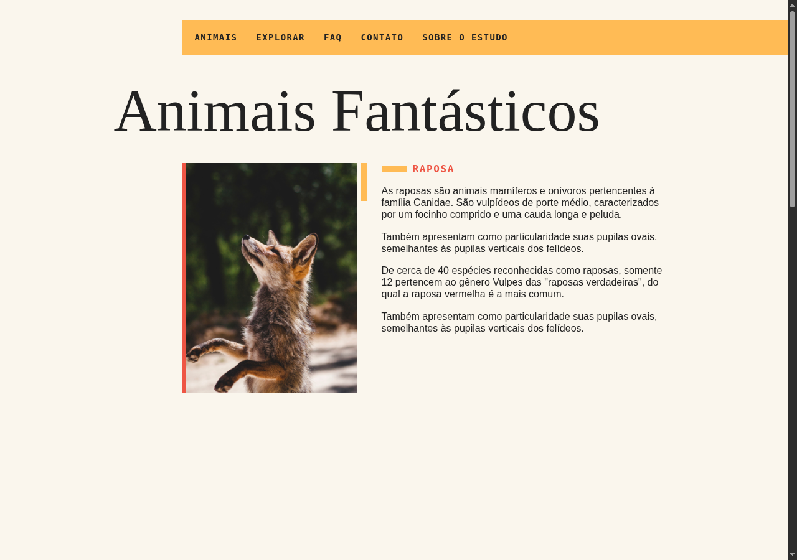

# Animais Fantásticos

Página interativa desenvolvida por Rafael Oliveira Rocha como estudo do curso **JavaScript Completo da Origamid**, com histórico de maio de 2022. O projeto registra o início da trajetória em desenvolvimento web e reúne manipulação do DOM, eventos, módulos JavaScript e consumo de dados em uma experiência visual sobre animais.



## Experimente

Com Python 3 instalado, execute na pasta do projeto:

```bash
python3 -m http.server 8000 --bind 127.0.0.1
```

Abra [http://127.0.0.1:8000/](http://127.0.0.1:8000/). O JavaScript compilado já está incluído; não é necessário instalar pacotes para navegar. Use um navegador atual com JavaScript habilitado e abra a página pelo servidor, pois o carregamento do JSON exige HTTP.

1. Selecione uma imagem para abrir a descrição do animal. Os botões também funcionam com Tab e Enter ou Espaço.
2. Abra e feche as respostas do FAQ e use **Explorar** para navegar pelas seções.
3. Abra **Sobre o estudo** para conhecer as interações. Escape fecha a janela e devolve o foco ao botão.
4. Observe os contadores carregados de [animaisapi.json](animaisapi.json) e o tooltip do mapa, disponível por mouse ou teclado.
5. Em telas pequenas, abra o menu para escolher um destino. A página respeita a preferência de movimento reduzido do dispositivo.

## Funcionamento e tecnologias

HTML, CSS Grid e JavaScript modular compõem a página, com seleção de conteúdo, perguntas expansíveis, menus, modal, tooltip e animações de rolagem. Webpack e Babel geram o arquivo [main.js/main.js](main.js/main.js) a partir de [js/script.js](js/script.js).

Os quatro contadores são **dados ilustrativos do exercício**, não um levantamento de fauna. Seus valores vêm do JSON local e permanecem os mesmos ao servir o projeto na raiz ou em uma subpasta. Se o arquivo estiver vazio ou indisponível, a seção mostra uma mensagem e o restante da página continua utilizável.

A área de contato usa exemplos neutros e um mapa ilustrativo. O indicador de horário compara o relógio local do navegador com o intervalo demonstrativo de segunda a sexta, das 8h às 18h. A conversão de R$ 100 para Bitcoin usa `100 / BRL.sell`, com quatro casas decimais, e depende da cotação pública da Blockchain.info e de conexão à internet. Sem cotação, a página informa sua indisponibilidade. Não há envio, transação ou autenticação.

## Alterar o código

Para reconstruir o bundle após editar os módulos ou acompanhar alterações:

```bash
npm ci
npm run build
# Durante o desenvolvimento:
npm run dev
```

Use Node.js e npm. As dependências e suas versões estão em [package.json](package.json) e [package-lock.json](package-lock.json). As imagens locais e a identidade visual foram preservadas; os textos e números compõem o conteúdo didático da página.

## Créditos

Estudo baseado no curso [JavaScript Completo da Origamid](https://www.origamid.com/curso/javascript-completo-es6/), com implementação e adaptações de Rafael Oliveira Rocha. O histórico original de maio de 2022 e os recursos visuais do projeto permanecem no repositório.
